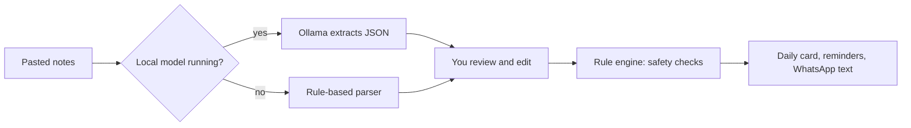

<div align="center">

# 💊 DoseBuddy

**Paste what the doctor said. Get a big-print daily medicine card and spoken reminders.**
Offline. Private. Free.

[](https://github.com/AbdulKhadhar/dosebuddy/actions/workflows/ci.yml)


<!-- Add a screenshot or GIF: docs/demo.gif -->
<!--  -->

</div>

> Not medical advice. DoseBuddy does not replace a doctor or pharmacist. Its interaction list is short and hand-written, so always confirm with a pharmacist.

## Why

Prescriptions are often written in English or medical shorthand, and several medicines taken at once are easy to mix up. DoseBuddy turns a typed note into a schedule one person can read at a glance, and keeps their health data on their own computer.

## Features

- **Paste once, get the plan.** Morning, afternoon and night compartments in large print.
- **Safety checks that are not AI.** Plain, testable Python flags clashes such as thyroid with calcium or iron, duplicates, and missing doses or times.
- **Review before trust.** Every extracted medicine can be edited before the plan is made.
- **Tick off doses.** Tap a medicine when taken and see "2 of 4 taken today" and the next dose.
- **Spoken reminders** in English, Hindi and Malayalam, using the browser's built-in voices.
- **Fridge card and WhatsApp text.** Print the card or copy a summary for family.
- **Optional local AI.** A small open-weight model (via Ollama) reads messy notes. Without it, built-in rules still work.
- **Zero dependencies, zero cost, zero cloud.**

## Quick start

| You are... | Do this |
|---|---|
| **Windows user** | Install [Python 3.9+](https://www.python.org/downloads/) (tick *Add to PATH*), then double-click **`start-windows.bat`** |
| **Mac / Linux** | Run **`./start-mac-linux.sh`** |
| **Developer** | `pip install -e ".[dev]"` then `dosebuddy` |

Your browser opens at http://127.0.0.1:8000. New to this? Read the **[step-by-step user guide](docs/USER_GUIDE.md)**.

### Optional: smarter reading with a local model

```bash
ollama pull qwen2.5:1.5b-instruct     # about 1 GB
# DoseBuddy detects it automatically. Use another model:
# set DOSEBUDDY_MODEL=gemma3:1b   (Windows)   export DOSEBUDDY_MODEL=gemma3:1b   (Mac/Linux)
```

## How it works



The model only reads text. **All safety decisions come from `rules.py`.**

## Project structure

```
dosebuddy/
├── src/dosebuddy/
│   ├── rules.py        # parsing fallback + safety checks (pure functions)
│   ├── llm.py          # optional Ollama client
│   ├── storage.py      # SQLite persistence (swap to change storage)
│   ├── server.py       # HTTP API, standard library only
│   ├── config.py       # settings via environment variables
│   ├── data/groups.json  # medicine groups: add drugs here, no code needed
│   └── static/index.html # the whole UI
├── tests/              # pytest: rules + end-to-end API
├── docs/               # user guide, DEV post
├── .github/workflows/  # CI (lint + tests) and tagged releases
├── start-windows.bat   # double-click launcher
└── start-mac-linux.sh
```

## Configuration

| Variable | Default | Purpose |
|---|---|---|
| `DOSEBUDDY_PORT` | `8000` | Local port |
| `DOSEBUDDY_MODEL` | `qwen2.5:1.5b-instruct` | Ollama model name |
| `DOSEBUDDY_OLLAMA_URL` | `http://127.0.0.1:11434` | Ollama address |
| `DOSEBUDDY_DATA` | `~/.dosebuddy` | Where the database lives |
| `DOSEBUDDY_NO_BROWSER` | unset | Set to skip auto-opening the browser |

## Extending it

- **Add medicines:** edit `src/dosebuddy/data/groups.json` (group name → brand and generic names).
- **Add a safety rule:** add a check in `rules.check()` and a test in `tests/test_rules.py`.
- **Add a language:** add an entry to `T` in `static/index.html`. Have a native speaker review it.
- **Run checks:** `ruff check . && pytest`

## Releases

Push a tag such as `v0.1.0` and GitHub Actions publishes a downloadable zip. Users unzip it and double-click the launcher.

## Privacy and limits

Everything runs on `127.0.0.1`. No accounts, no analytics, no outside requests (except to a local Ollama if you run one). The interaction list is intentionally small. Hindi and Malayalam reminder sentences are drafts. Reminders only speak while the page is open.

## License

MIT. See [LICENSE](LICENSE).
